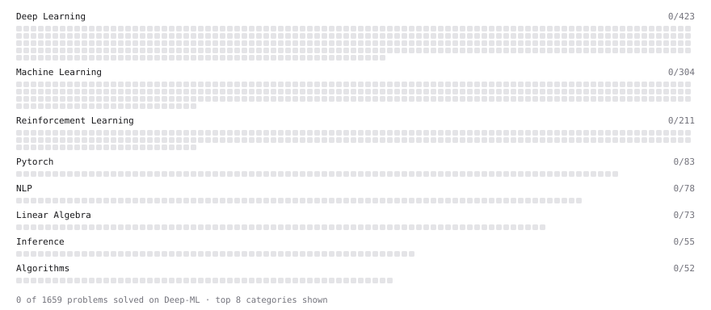

# Deep-ML

My machine learning practice from [Deep-ML](https://www.deep-ml.com). Every solution here was written by hand.

**4** solved · 0 problems · 0 labs · 4 math

[**Browse the interactive portfolio**](https://MontaigneMind.github.io/deep-ml/) to replay this filling in over time.

## Math

| | Difficulty | Solved | |
| --- | --- | --- | --- |
| [Derivatives and Gradients](https://www.deep-ml.com/math-problems/1) | easy | 2026-10-26 | [solution](math/0001-derivatives-and-gradients) |
| [Inverse and Rank](https://www.deep-ml.com/math-problems/12) | medium | 2026-10-26 | [solution](math/0012-inverse-and-rank) |
| [Matrix Multiplication](https://www.deep-ml.com/math-problems/10) | medium | 2026-10-26 | [solution](math/0010-matrix-multiplication) |
| [Solving Linear Systems](https://www.deep-ml.com/math-problems/13) | medium | 2026-10-26 | [solution](math/0013-solving-linear-systems) |

---

_This file is regenerated by Deep-ML on every push._
